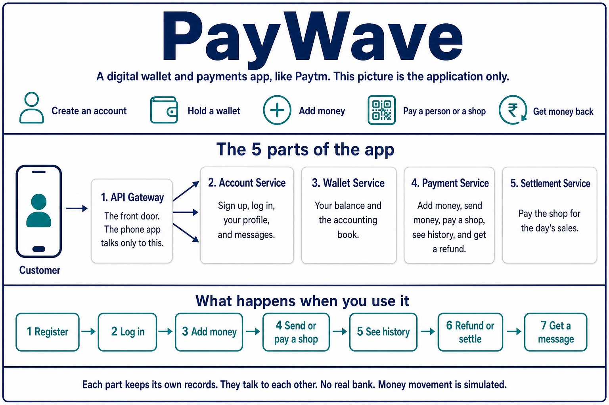
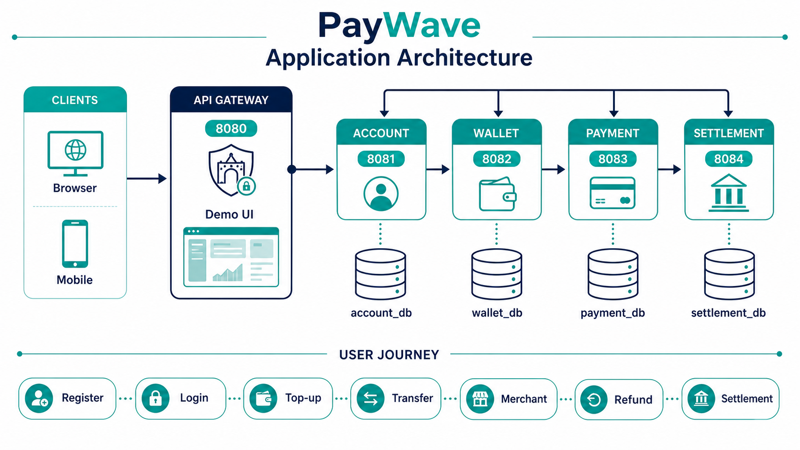
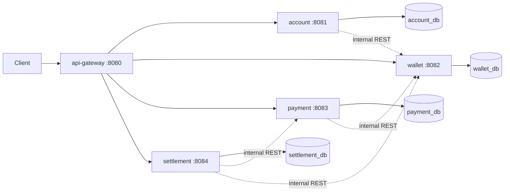
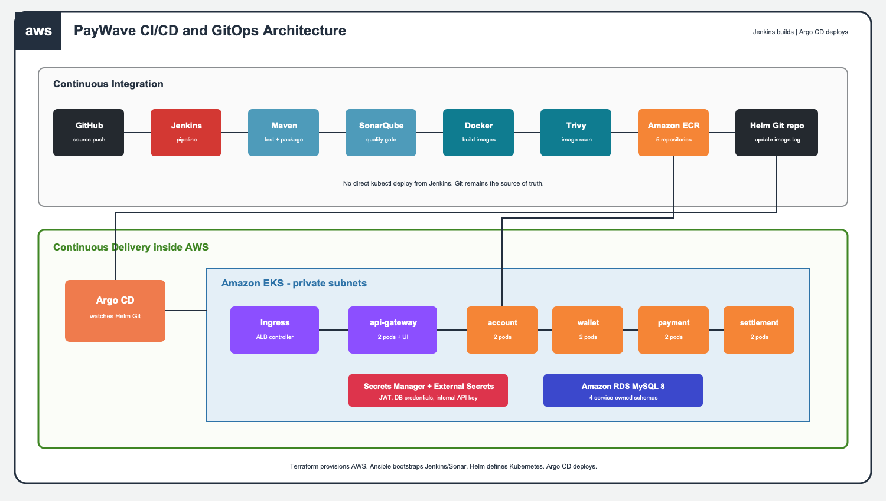
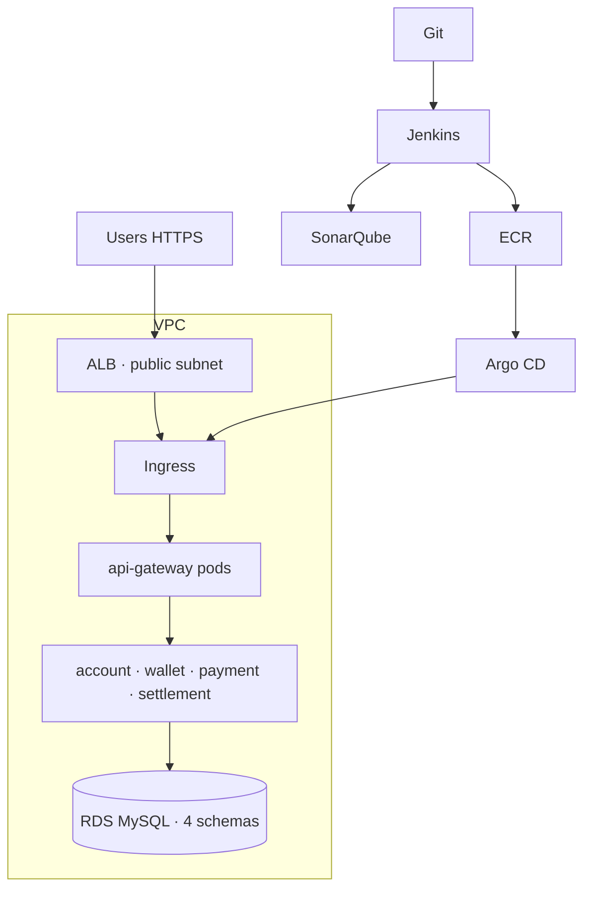

# PayWave

PayWave is a Paytm-style wallet and payments backend. A customer can register, hold a wallet, add money through a simulated gateway, pay another customer, pay a merchant, see history, request a refund, and run a merchant settlement.

**Stack:** Java 21 · Spring Boot 3 · MySQL 8 · Maven · API gateway (JWT) · optional demo UI in the gateway JAR.

Sample passwords in `.env.example` are for private development only. This codebase does **not** connect to real banks, card networks, or UPI.

---

## Status

| Layer | Status |
| --- | --- |
| **Application** | Five microservices + gateway; integration smoke test passed on EC2 |
| **Demo UI** | Embedded in `api-gateway` at `http://<host>:8080/` |
| **AWS / DevOps** | **In progress** — Terraform, EKS, RDS, Jenkins, SonarQube, Trivy, Argo CD (see below) |

---

## What the application does

A customer signs up and immediately receives a wallet. Adding money, sending money, and paying a merchant all go through one payment flow that updates the wallet and writes a balanced ledger entry. Merchants get a QR identity, can receive payments minus a 1.5% fee, and can be settled for a calendar day. Refunds reverse the money movement before settlement. The customer can read the resulting history and simulated email, SMS, and in-app messages.



---

## The five services

| Service | Port | Database | What it owns |
| --- | --- | --- | --- |
| api-gateway | 8080 | none | Public entry: routing, JWT, rate limits, **demo UI** |
| account-service | 8081 | account_db | Sign-in, profile, KYC, notifications |
| wallet-service | 8082 | wallet_db | Balances and double-entry ledger |
| payment-service | 8083 | payment_db | Payments, merchants, history, refunds |
| settlement-service | 8084 | settlement_db | Merchant settlement for one calendar day |

Clients use only the **gateway** (`8080`). Open `/` in a browser for the demo wallet UI. Optional **web-ui-service** (`8090`) is the same static UI as a separate process for local dev only.

Gateway routes: `/api/v1/auth`, `/users`, `/notifications` → account; `/wallets`, `/ledger` → wallet; `/payments`, `/transactions`, `/merchants`, `/refunds` → payment; `/settlements` → settlement.

---

## Architecture (application)

**View diagrams in Cursor:** open [`docs/assets/preview.html`](docs/assets/preview.html) in a browser, or open the `.svg` files and use **SVG Preview**.  
GitHub README [blocks many embedded SVGs](https://github.blog/changelog/2023-01-11-svg-support-for-github-readmes/); PNG below always works. Vector sources are linked.

| | README (PNG) | Vector (SVG) |
| --- | --- | --- |
| Application |  | [paywave-microservices-architecture.svg](docs/assets/paywave-microservices-architecture.svg) |
| AWS / DevOps | *(see next section)* | [paywave-aws-devops-architecture.svg](docs/assets/paywave-aws-devops-architecture.svg) |



Also: [image.png](image.png) (simple non-technical overview).

---

## AWS & DevOps (what we are building)

Target: run PayWave on **AWS** with **Terraform** (infrastructure), **EKS** (runtime), **RDS** (MySQL), **ECR** (images), **GitOps** (Helm + **Argo CD**), and **Jenkins** with **SonarQube** + **Trivy** in the pipeline. **Ansible** is for bootstrapping hosts (Jenkins/Sonar agents), not for app pod config—that is **Helm**.

Full roadmap: **[docs/aws-devops-roadmap.md](docs/aws-devops-roadmap.md)**  
**VPC / everything to create in AWS:** **[docs/aws-architecture.md](docs/aws-architecture.md)** + [full diagram SVG](docs/assets/paywave-aws-full-architecture.svg)  
**Build order (EKS + Argo last):** **[docs/aws-build-order.md](docs/aws-build-order.md)**





| Area | Tools |
| --- | --- |
| **IaC** | Terraform — VPC, NAT, EKS, RDS, ALB, Route53, ACM, ECR, Secrets Manager |
| **Config / deploy** | Helm charts, Argo CD (Jenkins updates image tag in Git; Argo syncs cluster) |
| **CI** | Jenkins — `mvn test`, Docker build, quality & security gates |
| **Quality** | SonarQube on source code |
| **Security** | Trivy on container images before ECR push |
| **Bootstrap** | Ansible for Jenkins / SonarQube / agents (optional) |

**Principles**

- Only **gateway** is internet-facing (ALB → Ingress → `api-gateway`).
- Backends stay **private** (ClusterIP); internal calls use `/internal/**` + `X-Internal-Api-Key`.
- **One deploy path:** image → ECR → Helm → Argo CD (no S3 `java -jar` on Kubernetes workers).
- **RDS** replaces Docker MySQL on the app host for non-dev environments.

Terraform/Ansible/Jenkins job definitions are **not in this repo yet**; this application repo stays the Java source of truth.

---

## Run locally / on EC2

Install **JDK 21** and **Maven 3.9**. Create four MySQL schemas (`docker/mysql/init.sh` can init them in Docker).

```bash
cp .env.example .env
set -a && source .env && set +a
./scripts/build-fat-jars.sh
# start MySQL, then each *-service JAR, then api-gateway — see docs/local-development.md
./scripts/e2e-smoke.sh http://localhost:8080
```

`PAYWAVE_MESSAGING_MODE=http` on wallet, payment, settlement when account-service should receive notification events.

---

## Money rules

- Amounts are INR with two decimal places.
- Wallet balance and ledger journal move together; journals are insert-only (reversals are new entries).
- Idempotency keys prevent duplicate money movement.
- Merchant fee **1.5%**; `.13` paise top-up fails; `.14` stays pending (demo rules).
- Refunds blocked after settlement.

---

## Documentation

| Doc | Topic |
| --- | --- |
| [AWS & DevOps roadmap](docs/aws-devops-roadmap.md) | Terraform, EKS, RDS, CI/CD, tools |
| [Architecture](docs/architecture.md) | Service boundaries and calls |
| [What each service does](docs/services.md) | Deep dive per service |
| [Local development](docs/local-development.md) | EC2, fat JARs, smoke test |
| [Database design](docs/database.md) | Schemas |
| [API reference](docs/api.md) | Endpoints |
| [Workflows](docs/workflows.md) | Business flows |
| [Environment variables](docs/environment.md) | Config |
| [Testing](docs/testing.md) | Unit and integration tests |
| [Diagram assets](docs/assets/README.md) | PNG/SVG, LinkedIn export |

No Dockerfiles in this repo yet—you add them when building images for ECR.