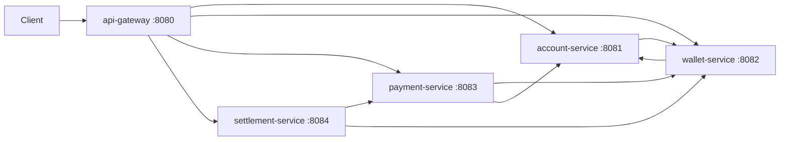

# Architecture

PayWave is five independently deployable processes. Each process owns one MySQL schema and does not read another service's tables. The client talks only to the API gateway. The gateway forwards to the service that owns the path.

Account-service holds registration, login, the customer profile, KYC, and notifications. Wallet-service holds the spendable balance and the accounting journal, so a wallet change and its ledger account live in one database. Payment-service holds the payment, the merchant, the history row, and the refund. Settlement-service reads unsettled merchant payments and pays the remaining net.

Inside a service, those former boundaries are ordinary Java calls. Across services, calls use REST on `/internal/**` with `X-Internal-Api-Key`. The gateway refuses `/internal/**`.

Wallet, payment, and settlement write an outbox row in the same database as the business change. A relay delivers it. `log` prints the event. `http` posts it to account-service. `kafka` publishes `paywave.domain-events` and is off unless you set that mode.

`paywave-common` is the response envelope, money rounding, and JWT helper. `paywave-web` is servlet security, the exception handler, and the outbox relay. Neither one is a running service. The gateway depends only on `paywave-common`.
