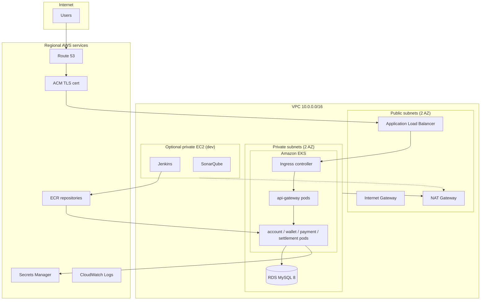

# PayWave AWS architecture (what to build)

Everything below is the **target** layout for Terraform/Ansible/Jenkins/EKS. Nothing here is deployed yet unless you create it.

Use this with:

- [`assets/paywave-aws-full-architecture.svg`](assets/paywave-aws-full-architecture.svg) — VPC blocks (open in browser: [`preview.html`](assets/preview.html))
- [`aws-devops-roadmap.md`](aws-devops-roadmap.md) — CI/CD tools and phases

---

## Accounts and regions

| Choice | Recommendation |
| --- | --- |
| **Regions** | Start with **one** (e.g. `ap-south-1` Mumbai, near your users) |
| **Accounts** | **One** AWS account for dev/staging; add a second **prod** account later |
| **Environments** | `dev` first, then `staging`, then `prod` (separate VPCs or separate accounts) |

---

## High-level request flow (numbered)

```text
 ① User (browser) → Route 53 (xyz.com)
 ② → ACM certificate (HTTPS on ALB)
 ③ → Application Load Balancer (public subnets)
 ④ → EKS Ingress → api-gateway Service (only public HTTP path)
 ⑤ → ClusterIP Services: account, wallet, payment, settlement
 ⑥ → Amazon RDS MySQL (private subnets, four schemas)
```

**CI/CD (parallel path, no user traffic):**

```text
 ⑦ Developer push → Git (GitHub)
 ⑧ → Jenkins: mvn test, SonarQube, docker build, Trivy
 ⑨ → Push image → Amazon ECR (one repo per service)
 ⑩ → Update Helm chart / image tag in Git
 ⑪ → Argo CD syncs → Kubernetes (same EKS cluster)
```

**Infrastructure lifecycle:**

```text
 ⑫ Terraform: VPC, subnets, NAT, EKS, RDS, ALB, ECR, IAM, Secrets Manager, Route 53, ACM
 ⑬ Ansible (optional): install Jenkins, SonarQube, agents on EC2 — not for app pods (use Helm)
```

---

## VPC layout (one environment)

Typical CIDR: **`10.0.0.0/16`**

| Resource | Count | Purpose |
| --- | --- | --- |
| **VPC** | 1 | Isolated network |
| **Availability Zones** | 2 | HA (EKS + RDS requirement) |
| **Public subnets** | 2 (e.g. `10.0.1.0/24`, `10.0.2.0/24`) | ALB, NAT Gateway |
| **Private subnets** | 2 (e.g. `10.0.11.0/24`, `10.0.12.0/24`) | EKS nodes, RDS |
| **Internet Gateway** | 1 | Public internet for ALB |
| **NAT Gateway** | 1 (dev) or 2 (prod) | Private subnets pull images (ECR) and patches |
| **Elastic IP** | 1 per NAT | NAT public address |
| **Route tables** | 2 patterns | Public → IGW; private → NAT |

### Inside the VPC (logical blocks)



---

## What Terraform should create (module checklist)

### Network

- [ ] `aws_vpc`
- [ ] `aws_subnet` (public ×2, private ×2)
- [ ] `aws_internet_gateway`
- [ ] `aws_eip` + `aws_nat_gateway`
- [ ] `aws_route_table` + associations
- [ ] `aws_security_group` (ALB, EKS nodes, RDS, optional Jenkins)

### Edge and DNS

- [ ] `aws_lb` (ALB) + listeners **443** → target group → Ingress
- [ ] `aws_acm_certificate` (+ DNS validation via Route 53)
- [ ] `aws_route53_record` (A/AAAA alias to ALB)

### Compute (EKS)

- [ ] `aws_eks_cluster`
- [ ] `aws_eks_node_group` (or Karpenter later; start with one node group)
- [ ] `aws_iam_openid_connect_provider` + **IRSA** roles for Ingress controller, External Secrets, etc.
- [ ] EKS addons: VPC CNI, CoreDNS, kube-proxy, **AWS Load Balancer Controller**

### Data

- [ ] `aws_db_subnet_group` (private subnets only)
- [ ] `aws_rds_cluster` or `aws_db_instance` — **MySQL 8**
- [ ] Four databases/schemas (same as today): `account_db`, `wallet_db`, `payment_db`, `settlement_db`
- [ ] `aws_secretsmanager_secret` for DB master + app secrets

### Registry and artifacts

- [ ] `aws_ecr_repository` ×5 (gateway, account, wallet, payment, settlement) — skip separate web-ui (UI in gateway image)

### IAM and state

- [ ] Terraform backend: **S3** bucket + **DynamoDB** table (state lock)
- [ ] IAM roles for Terraform deploy role, Jenkins (ECR push), EKS IRSA

### Not in VPC but required

- [ ] CloudWatch log groups (or container logs via EKS)
- [ ] Optional: **AWS WAF** on ALB

---

## Security groups (who talks to whom)

| From | To | Port | Notes |
| --- | --- | --- | --- |
| `0.0.0.0/0` | ALB | 443 | Internet users |
| ALB | EKS node / Ingress | 30000-32767 or target port | Depends on Ingress implementation |
| EKS pods | RDS | 3306 | Only from node SG or dedicated app SG |
| EKS nodes | ECR API | 443 | Via NAT |
| Jenkins (optional EC2) | ECR, Git | 443 | Build pipeline |
| **Nobody** | RDS | from internet | **Deny** |

Internal PayWave traffic stays **inside the cluster**: `http://wallet-service:8082/internal/...` with `X-Internal-Api-Key`.

---

## Kubernetes layout (Helm / Argo CD)

| K8s object | PayWave mapping |
| --- | --- |
| **Namespace** | `paywave` |
| **Deployment + Service** | One per service (5 deployments) |
| **Ingress** | Host `xyz.com` → **api-gateway** only |
| **Service type** | `ClusterIP` for all backends |
| **ConfigMap** | Non-secret env (service URLs, ports) |
| **Secret** | From External Secrets ← Secrets Manager |
| **HPA** (later) | Scale on CPU for gateway/payment |

**Replicas (your plan):** 2 pods each for gateway + 4 backends (dev can use 1).

**Do not deploy** `web-ui-service` in AWS if the gateway image already serves `/`.

---

## Jenkins, SonarQube, Argo CD (where they run)

| Component | Typical placement (portfolio / dev) |
| --- | --- |
| **Jenkins** | EC2 in **private** subnet + VPN/bastion/SSM, **or** Jenkins on small public EC2 with locked SG (dev only) |
| **SonarQube** | EC2 or SonarCloud (SaaS is easier) |
| **Argo CD** | **Inside EKS** (Helm install) — GitOps UI |
| **Trivy** | Jenkins agent step (no persistent server) |
| **Ansible** | Bootstrap Jenkins/Sonar EC2; not for EKS app config |

---

## S3 buckets (names to plan)

| Bucket purpose | Example name pattern |
| --- | --- |
| Terraform state | `paywave-tfstate-ap-south-1` |
| ALB access logs (optional) | `paywave-alb-logs-…` |
| Jenkins backup (optional) | `paywave-jenkins-backup-…` |
| **Not** primary runtime | Avoid “run JAR from S3 on EKS” |

---

## Environment variables at runtime (from Secrets Manager)

Same concepts as `.env.example`, but **no plain text in Git**:

- `JWT_SECRET`, `INTERNAL_API_KEY`
- Per-service `DB_URL`, `DB_USERNAME`, `DB_PASSWORD`
- `PAYWAVE_MESSAGING_MODE=http`
- Gateway: `ACCOUNT_SERVICE_URL=http://account-service:8081` (K8s DNS names)

---

## Phased build order (recommended)

| Phase | You create | PayWave runs |
| --- | --- | --- |
| **1** | VPC, RDS, EC2, ALB→8080, Docker MySQL **off** | JARs or single-host Docker (like today) |
| **2** | ECR, Dockerfiles, EKS, Helm, Argo CD | Containers on EKS |
| **3** | Jenkins pipeline, SonarQube, Trivy gates | Full CI/CD |
| **4** | WAF, multi-AZ NAT, prod account | Hardening |

---

## Cost awareness (24/7 dev)

Rough monthly drivers: **EKS control plane**, **NAT Gateway**, **RDS**, **EC2 nodes**. Teardown NAT/EKS/RDS when not studying to save money.

---

## Diagram file

Open **`docs/assets/paywave-aws-full-architecture.svg`** for the boxed VPC view with numbered steps (similar to AWS reference architectures).

```bash
open docs/assets/preview.html
```