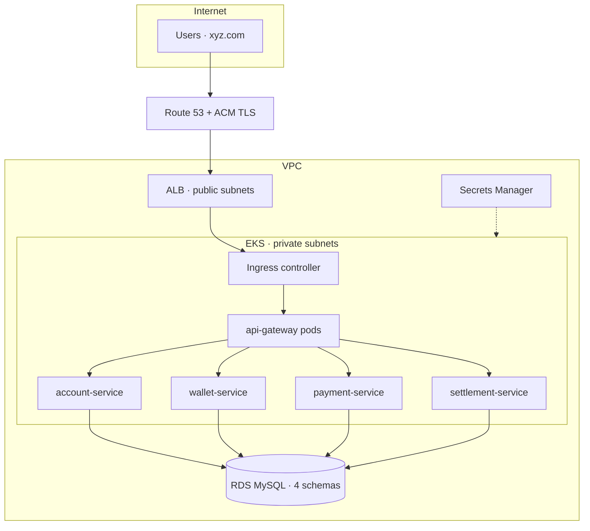
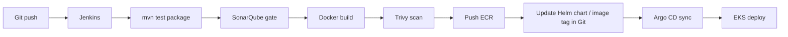

# AWS & DevOps roadmap

PayWave is **application-complete** (runtime verified on EC2: gateway, smoke test, demo UI). This document describes the **target AWS platform** and **tooling** in progress—implemented with Terraform, Ansible, Jenkins, and GitOps.

Infrastructure code for AWS is **not in this repo yet**; it will live in a separate Terraform project or `infra/` when you add it.

## Goals

- One **public** entry: HTTPS → ALB → **api-gateway** (includes demo UI).
- Four **private** backends on Kubernetes (or initially EC2 + systemd during Phase 1).
- **Amazon RDS MySQL 8** with four schemas (`account_db`, `wallet_db`, `payment_db`, `settlement_db`).
- **Container images in ECR**; deploy with **Helm + Argo CD** (GitOps).
- **Jenkins** pipeline: build, test, **SonarQube**, image scan (**Trivy**), push ECR, update Helm values in Git.
- **Terraform** for VPC, subnets, NAT, EKS, RDS, ALB, ECR, IAM, Secrets Manager.
- **Ansible** for bootstrap (Jenkins agent, SonarQube host, bastion/SSM helpers)—not for per-pod config (that is Helm).

## What is done today (Phase 0)

| Item | Status |
| --- | --- |
| Five Spring Boot services + gateway | Done in this repo |
| MySQL (Docker on EC2 or local) | Done for dev/demo |
| Fat JAR build (`repackage`) | Done; see `scripts/build-fat-jars.sh` |
| Demo UI in gateway | Done |
| EC2 manual run + `e2e-smoke.sh` | Done |

## Target AWS architecture (Phase 2)

### Network (Terraform)

- 1 **VPC**, **2 AZs**
- **2 public** subnets: ALB, NAT gateway, Elastic IPs
- **2 private** subnets: EKS worker nodes, RDS
- **Internet Gateway** (public), **NAT Gateway** (private outbound)
- Security groups: only **443** from world to ALB; backends **no public ingress**

### Runtime (EKS)

- **1 EKS cluster** (dev/staging can use a single small node group)
- **2 pods per service** for rolling updates (gateway + 4 backends)
- **ClusterIP** for internal services; only **Ingress** exposes gateway
- Service-to-service: cluster DNS + existing **`/internal/**`** + **`X-Internal-Api-Key`**
- **web-ui-service**: skip in prod (UI is inside gateway)

### Data

- **RDS MySQL 8**, Multi-AZ optional for prod
- Flyway migrations per service unchanged
- No MySQL on application hosts in target state

### Secrets & IAM

- **Secrets Manager** (or SSM): DB passwords, `JWT_SECRET`, `INTERNAL_API_KEY`
- **External Secrets Operator** or CSI driver → Kubernetes secrets → Helm values
- **IRSA** for pods that call AWS APIs (no long-lived keys in images)

### Observability

- **CloudWatch** logs from containers
- Use existing **`X-Correlation-Id`** across gateway and services
- Optional: Container Insights, X-Ray later

## CI/CD (single deploy path)

| Step | Tool | Notes |
| --- | --- | --- |
| Build | Jenkins | JDK 21, `mvn clean package`, fat JAR inside image |
| Quality | SonarQube | Fail pipeline on your quality gate |
| Security | Trivy | Scan image before ECR; block CRITICAL if you choose |
| Registry | **ECR** | One repo per service (or monorepo image tags) |
| Deploy | **Argo CD** | Jenkins does **not** kubectl apply; Git is source of truth |
| Charts | **Helm** | Replicas, env, secrets refs, resource limits |

**Do not** use S3 + `java -jar` on workers when the target is EKS—that pattern is for bare EC2 only.

## Tool roles

| Tool | Responsibility |
| --- | --- |
| **Terraform** | AWS resources: VPC, EKS, RDS, ALB, ECR, Route53, ACM, IAM, Secrets Manager |
| **Ansible** | Install/config Jenkins, SonarQube, pipeline agents; optional bastion |
| **Helm** | Kubernetes manifests per service |
| **Argo CD** | Watch Git; deploy to EKS |
| **Jenkins** | CI: build, test, scan, push ECR, commit image tag |
| **SonarQube** | Static analysis on source |
| **Trivy** | Vulnerability scan on container images |

## Suggested implementation phases

1. **Phase 1** — Terraform: VPC + RDS + EC2 + ALB (8080), JARs or Docker on one host (cheapest learning step).
2. **Phase 2** — Dockerfiles in repo → ECR → EKS + Helm + Argo CD (matches diagram).
3. **Phase 3** — Jenkins + SonarQube + Trivy wired to the pipeline; staging environment.

## Diagram files

| Format | Path | Use |
| --- | --- | --- |
| PNG (GitHub README) | `docs/assets/*.png` | Renders reliably on GitHub |
| SVG (edit/export) | `docs/assets/*.svg` | Open locally or Inkscape → LinkedIn PNG |
| App overview | `image.png` | Non-technical summary |

See [docs/assets/README.md](assets/README.md) for LinkedIn export and captions. (Path from repo root: `docs/assets/README.md`.)